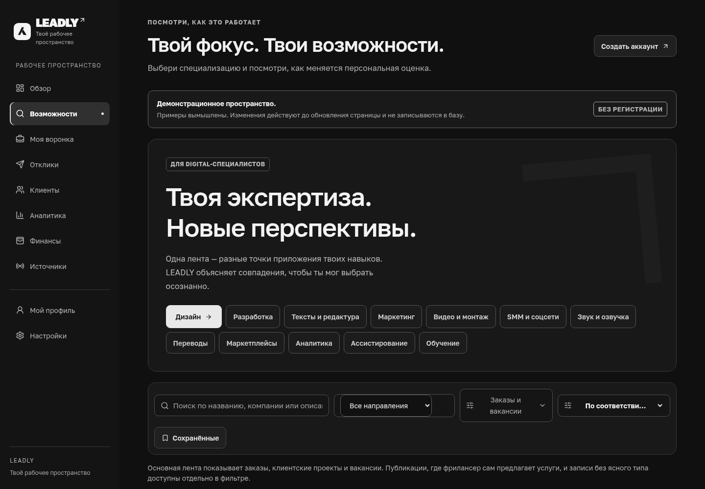

# LEADLY — обновлённый дизайн

19 октября 2026. Выбранное направление: **спокойный премиальный интерфейс**, тёмная чёрно-белая основа, чистая сетка и сдержанные анимации.

Ниже — скриншоты реализованного приложения. Их можно посмотреть прямо на этой странице, без установки проекта. В демонстрации используются вымышленные задания; персональные аккаунты и их записи в галерею не включены.

## Вход и регистрация

На большом экране форма получила отдельную зону бренда. Основное действие — работа с почтовым аккаунтом; другие способы входа расположены ниже и показывают фактическую доступность. На телефоне остаётся компактная форма.

## Лента возможностей

Навигация разделена на работу и управление. Сокращены вводные блоки, фильтры выровнены по общей сетке. Название, описание, бюджет, оценки и действия читаются последовательно.

Подробности оценки раскрываются по запросу. Информация о неподтверждённом бюджете остаётся видна в основной карточке.

## Телефон

Дополнительные фильтры раскрываются отдельной кнопкой, профессии прокручиваются в своей строке, меню учитывает высоту экрана. Рабочие страницы проверены на ширинах 390 и 320 px.

<table><tr><td valign="top"></td><td valign="top"></td></tr></table>

Лента до изменений

## Остальные рабочие экраны

| Экран | Что изменилось |
| --- | --- |
| Главная | Компактный следующий шаг, фактическая цель месяца с прогрессом, спокойные карточки показателей |
| Профиль | Навигация по разделам, две колонки на большом экране, последовательная форма на телефоне |
| CRM | Ровные колонки, аккуратные карточки, понятные пустые этапы; на телефоне одна колонка |
| Клиенты | Список и форма в общей сетке, пустое состояние с переходом к добавлению контакта |
| Финансы | Единые показатели и журнал, форма операции, пустое состояние с переходом к первой записи |
| Отклики | Настройки рядом с редактором на большом экране; последовательные шаги на телефоне |
| Аналитика | Спокойная сетка графика и общая типографика показателей |
| Источники и настройки | Плитки на одной линии, согласованные заголовки, поля и статусы |
| Тарифы | Четыре согласованные карточки только в профиле, с прежними ценами и предварительным выбором |

Типографика основана на локальном Golos Text с кириллицей: основной текст и поля — 16 px, заголовки и вспомогательный текст имеют разные уровни. Фокус с клавиатуры виден, анимации учитывают уменьшение движения. Общая визуальная система находится в `app/design-system.css`.

## Проверки

- Lint, 198 локальных проверок и production build с TypeScript прошли.
- 16 изолированных браузерных тестов прошли на компьютере и телефоне, включая открытие мобильных фильтров и выбор разных профессий.
- Все 18 сценариев с настоящей Supabase-сессией повторно прошли после редизайна: вход, профиль, onboarding, карточка задания, CRM, контакты, финансы и экспорт, сохранение и открытие отклика, выход.
- Автоматический axe-аудит пяти страниц с авторизацией не выявил нарушений WCAG A/AA. Публичные вход/демо дополнительно проверены на 1440, 390 и 320 px: шесть проверок без находок и горизонтального переполнения. Отдельно проверено, что элементы фильтров не перекрываются.
- Десять рабочих экранов проверены на трёх ширинах: 30 просмотров. Временные тестовые аккаунты и их данные очищены, исходные счётчики восстановлены.

Перед правками сохранён архив исходников. Проверки проводились с сохранённой TLS-валидацией и изоляцией пользователей. Это автоматические проверки и визуальный просмотр, а не полный ручной аудит доступности.

Приоритет остаётся на дизайне. Telegram Mini App/бот, реальные подключения источников, OAuth/SMTP и оплата сохраняются в дальнейших этапах. Выбранное направление учтено; окончательная пользовательская оценка этого визуального варианта ещё не получена.
