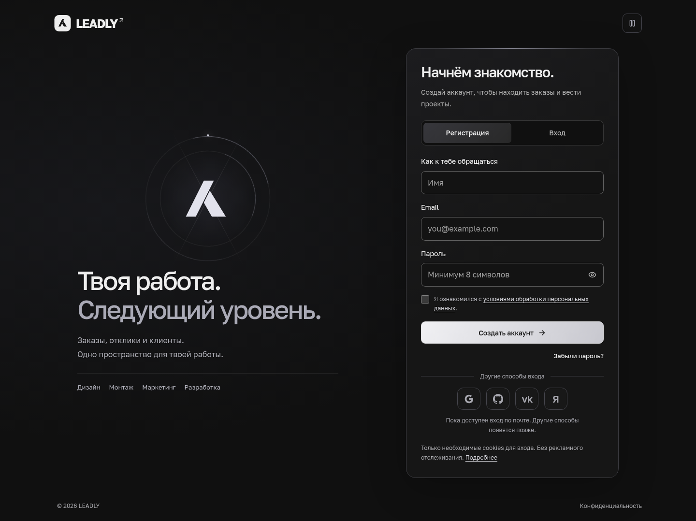
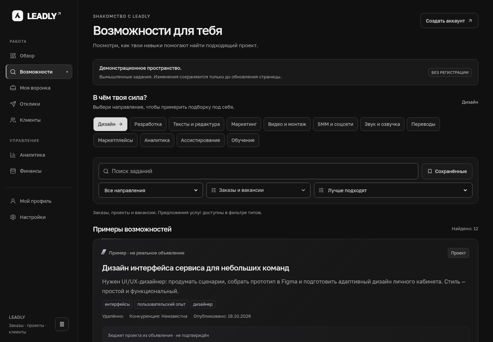
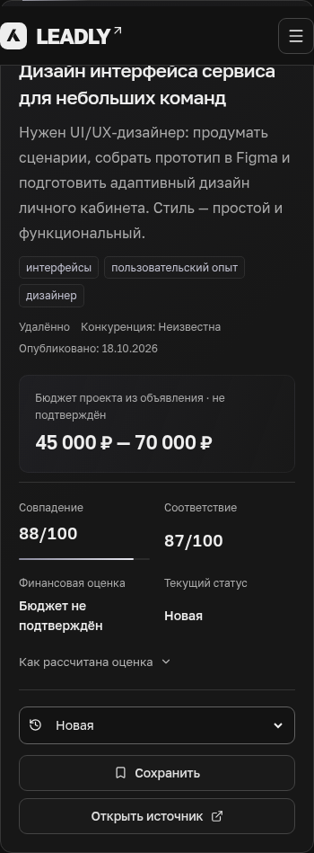
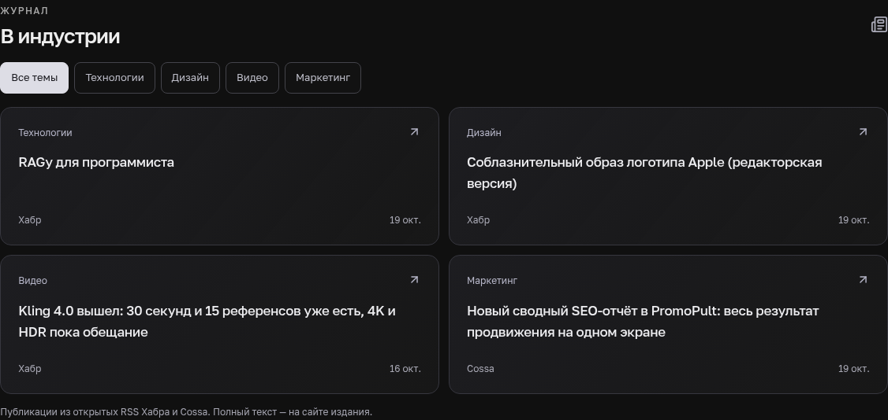
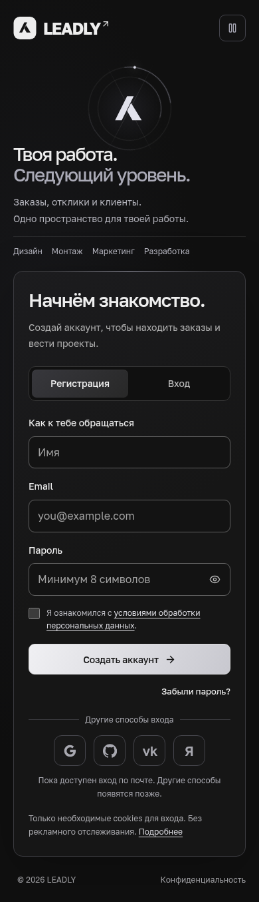
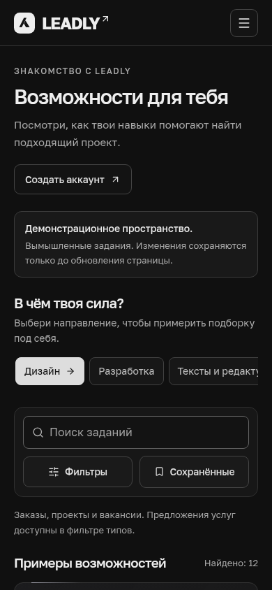
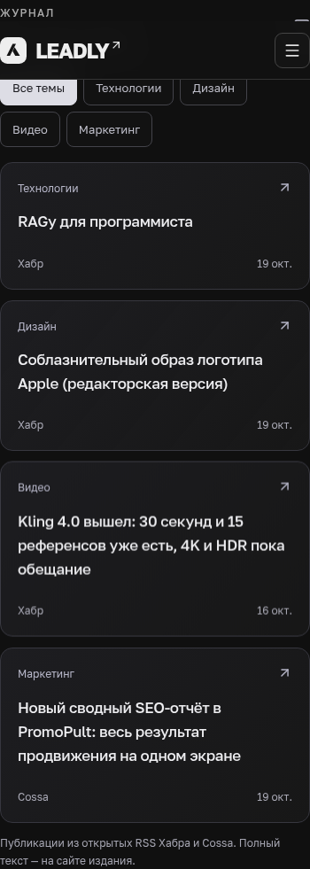

# LEADLY — фирменный интерфейс

19 октября 2026, по Москве. Тёмная основа, спокойные градиенты, собственный знак и движение линий. Русский интерфейс и рабочие формы сохранены. Убраны декоративные звёздочки, подписи со скриншотов, маркетинговая нумерация и лишние лозунги.

Здесь реальные снимки публичных страниц приложения. Задания в демонстрации вымышлены; новости приходят из RSS изданий. Персональных записей и ключей в галерее нет.

## Вход

Знак LEADLY появляется первым, затем раскрываются заголовок и текст. Линии вокруг знака движутся плавно. Форму можно использовать сразу. Другие способы входа оформлены иконками с доступными названиями; неподключённые провайдеры честно обозначены как недоступные. Демо не служит кнопкой входа в личное приложение.

После настоящего входа открывается короткое персональное приветствие с кнопкой «Продолжить», затем — главная либо первичная настройка профиля. Приветствие требует сессию и не заменяет проверку авторизации. Личные маршруты закрываются до показа интерфейса гостю.

## Возможности

Карточки получили фирменный знак источника, световой акцент, совпавшие навыки, полосу совпадения и отдельную поверхность бюджета. Наведение подчёркивает карточку, сохраняя положение текста. Полное длинное описание доступно через раскрытие. Объяснение оценок и предупреждения о неподтверждённом бюджете сохранены.

## Журнал индустрии

На главной — публикации по технологиям, дизайну, видео и маркетингу из открытых RSS Хабра и Cossa. В каждой карточке есть издание, настоящая дата и ссылка на оригинал. Темы переключаются без перезагрузки. При недоступности ленты показывается честное пустое состояние со ссылкой на издание. Заголовки кешируются на сервере на 15 минут; загрузка новостей не блокирует основную часть главной.

## Телефон

Брендовая зона остаётся доступной в компактном виде. Поля, фильтры, описания, оценки и действия сохраняют функциональность настольной версии. Дополнительные фильтры раскрываются, длинные материалы можно прочитать полностью.

<table><tr><td valign="top"></td><td valign="top"></td></tr></table>

## Поведение и данные

- Анимации используют CSS transform/opacity и небольшие локальные blur-переходы. Тяжёлых библиотек, canvas и покадрового JavaScript нет. Фоновые циклы останавливаются вне экрана и в скрытой вкладке. Есть постоянная кнопка паузы и поддержка `prefers-reduced-motion`.
- Источники убраны из пользовательской навигации и настроек. Служебная страница доступна только UUID операторов из серверной переменной `LEADLY_OPERATOR_USER_IDS`; пустой список запрещает доступ всем. Наличие серверного ключа не даёт пользователю права оператора.
- При регистрации требуется ознакомление с обработкой данных; версия уведомления и время сохраняются в метаданных нового аккаунта. Используются необходимые cookies сессии. Рекламных трекеров нет, поэтому баннер выбора рекламных cookies не добавлен. Пауза анимаций сохраняется локально.
- Все четыре тарифа остаются только в профиле: FREE, PRO 990 ₽, PRO+ 2 490 ₽, AGENCY 4 990 ₽ в месяц. Это предварительный выбор; реальная оплата не подключена.

Правила визуала закреплены в [AGENTS.md](../AGENTS.md) для дальнейшей работы с репозиторием. В других проектах этот файл нужно передать отдельно; глобальная память аккаунта этим не настраивается.

## Проверки

Результаты финального прогона этой версии фиксируются в последней записи [CHECKPOINT](CHECKPOINT.md). Скриншоты проверяются на 1440, 390 и 320 px, включая переполнение, фильтры и доступность. Живые сценарии проверяются на отдельных временных аккаунтах с последующей очисткой.

Реальные Google/социальный вход, стабильный импорт всех заданий, Telegram Mini App, бот и платежи остаются дальнейшими этапами. Перед коммерческим запуском оператору также нужно заполнить свои реквизиты, контакт для запросов и окончательные юридические документы. Эти подключения и юридическая готовность не подменяются новым дизайном.
